# Student Depression Prediction Using Machine Learning

A machine learning project for analyzing student depression labels using academic, lifestyle, demographic, and self-reported factors. This project implements multiple classification algorithms, cross-validation, hyperparameter tuning, feature importance analysis, SHAP explainability, and a Streamlit application.

> **Disclaimer:** This project is intended for educational and research purposes only. It is not a clinical diagnostic tool and must not be used to diagnose depression or make decisions about an individual's mental health.

## Overview

Student mental well-being can be associated with several factors, including academic pressure, financial stress, sleep duration, study satisfaction, lifestyle habits, and personal circumstances.

This project explores these factors using machine learning and compares multiple classification models to understand their predictive performance and behavior.

### Key Features

- Exploratory Data Analysis (EDA)
- Data inspection, cleaning, and preprocessing
- Depression label distribution analysis
- Multiple machine learning classification models
- Cross-validation and model performance comparison
- XGBoost hyperparameter tuning
- Confusion matrix visualization
- Feature importance analysis
- SHAP-based model explainability
- Sensitive-feature experimentation
- Streamlit application for interactive exploration and prediction

## Machine Learning Models

The project evaluates the following classifiers:

- Logistic Regression
- Decision Tree
- Random Forest
- Support Vector Machine (SVM)
- XGBoost

Model evaluation and tuning results are saved in the `results/` directory.

## Tech Stack

- **Programming Language:** Python
- **Data Processing:** Pandas, NumPy
- **Data Visualization:** Matplotlib, Seaborn
- **Machine Learning:** Scikit-learn, XGBoost
- **Explainable AI:** SHAP
- **Application:** Streamlit
- **Model Serialization:** Joblib/Pickle-compatible model artifacts

## Project Structure

```text
minor/
├── README.md
├── requirements.txt
├── assets/
│   ├── academic_pressure_vs_depression.png
│   ├── age_distribution.png
│   ├── cgpa_distribution.png
│   ├── depression_distribution.png
│   ├── family_history_vs_depression.png
│   ├── financial_stress_vs_depression.png
│   ├── sleep_duration_vs_depression.png
│   ├── decision_tree_confusion_matrix.png
│   ├── logistic_regression_confusion_matrix.png
│   ├── random_forest_confusion_matrix.png
│   ├── svm_confusion_matrix.png
│   ├── xgboost_confusion_matrix.png
│   ├── xgboost_feature_importance.png
│   └── shap_summary.png
├── dataset/
│   ├── cleaned_student_depression.csv
│   └── Student Depression Dataset.csv
├── models/
│   ├── best_depression_model.pkl
│   ├── final_depression_model.pkl
│   ├── final_model.py
│   └── tuned_xgboost_model.pkl
├── results/
│   ├── cross_validation_summary.csv
│   ├── feature_importance.csv
│   ├── final_model_results.csv
│   ├── model_results.csv
│   └── xgboost_hyperparameter_results.csv
└── src/
    ├── app.py
    ├── clean_data.py
    ├── cross_validation.py
    ├── eda.py
    ├── feature_analysis.py
    ├── inspect_dataset.py
    ├── sensitive_feature_experiment.py
    ├── shap_analysis.py
    ├── train_model.py
    └── tune_xgboost.py
```

## Dataset

The project uses a student depression dataset and a cleaned version produced during preprocessing.

The dataset contains student-related demographic, academic, lifestyle, and self-reported information, along with a binary depression label.

Example features include:

- Age and demographic attributes
- Academic pressure
- Study satisfaction
- CGPA
- Work/study hours
- Sleep duration
- Dietary habits
- Financial stress
- Family history of mental illness
- Self-reported history of suicidal thoughts

**Target variable:** `Depression`

The dataset's labels should not be interpreted as independently verified clinical diagnoses.

### Data Privacy and Licensing

Before publishing the dataset, verify its original source, license, redistribution permissions, and privacy implications. The dataset includes sensitive mental-health-related attributes. If redistribution is not permitted, exclude the CSV files from the public repository and document how authorized users can obtain the dataset.

## Exploratory Data Analysis

The following visualizations illustrate the distribution of depression labels and selected demographic, academic, and lifestyle variables.

### Depression Distribution

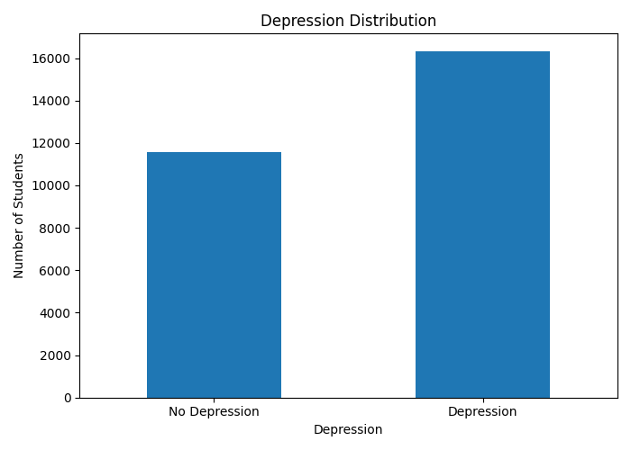

### Age Distribution

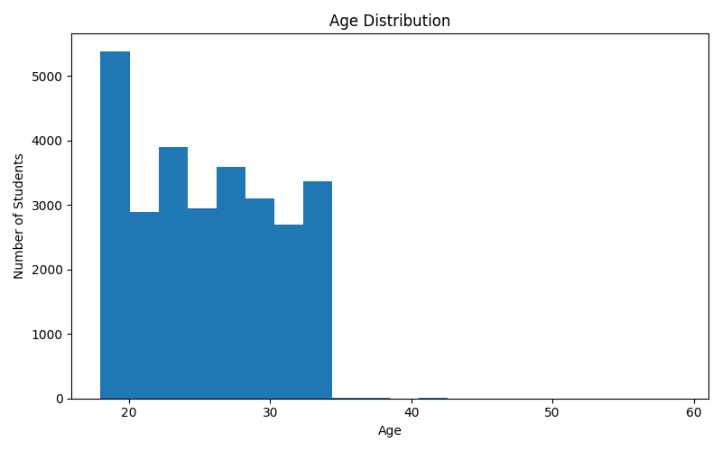

### CGPA Distribution

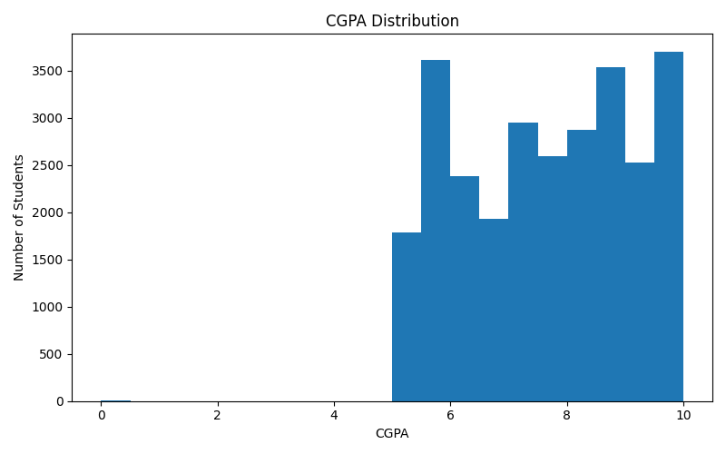

### Academic Pressure vs Depression

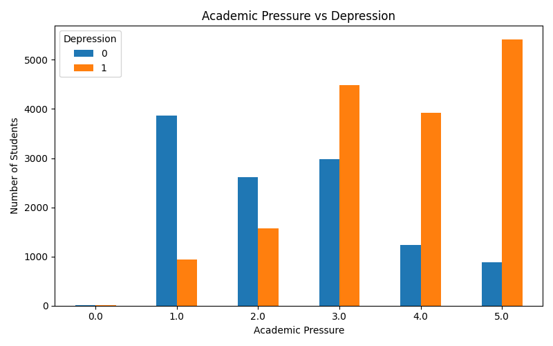

### Sleep Duration vs Depression

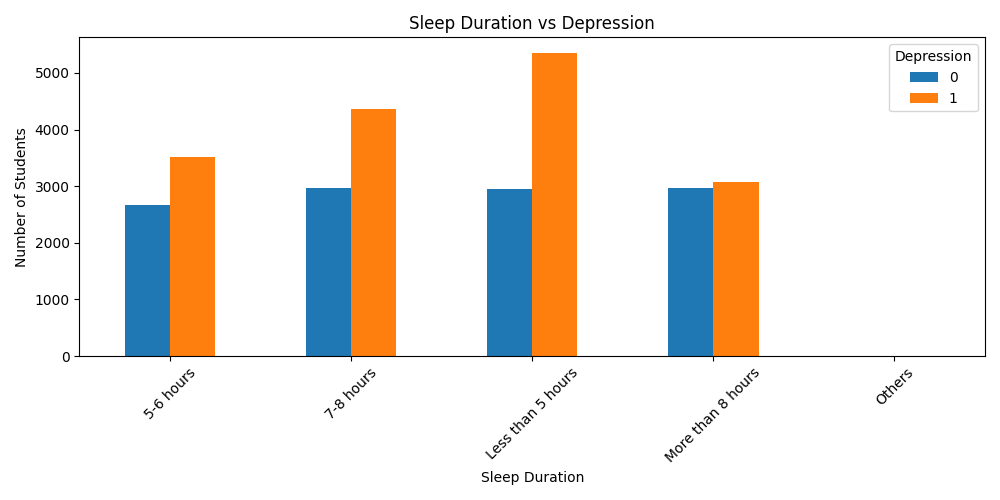

### Family History vs Depression

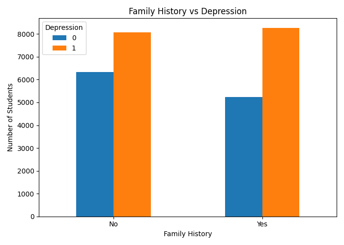

### Financial Stress vs Depression

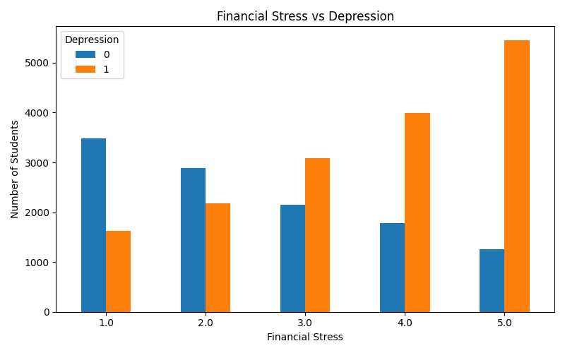

These visualizations describe patterns and associations in the dataset. They do not establish causation.

## Model Evaluation

Confusion matrices are used to examine correct classifications and errors for individual models.

### Decision Tree

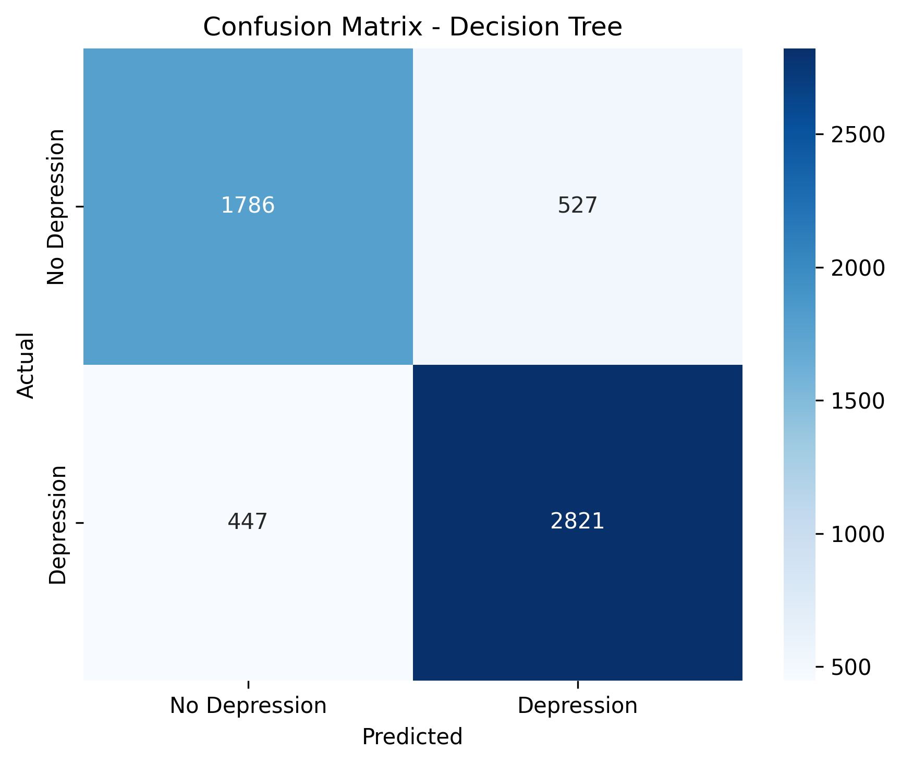

### Logistic Regression

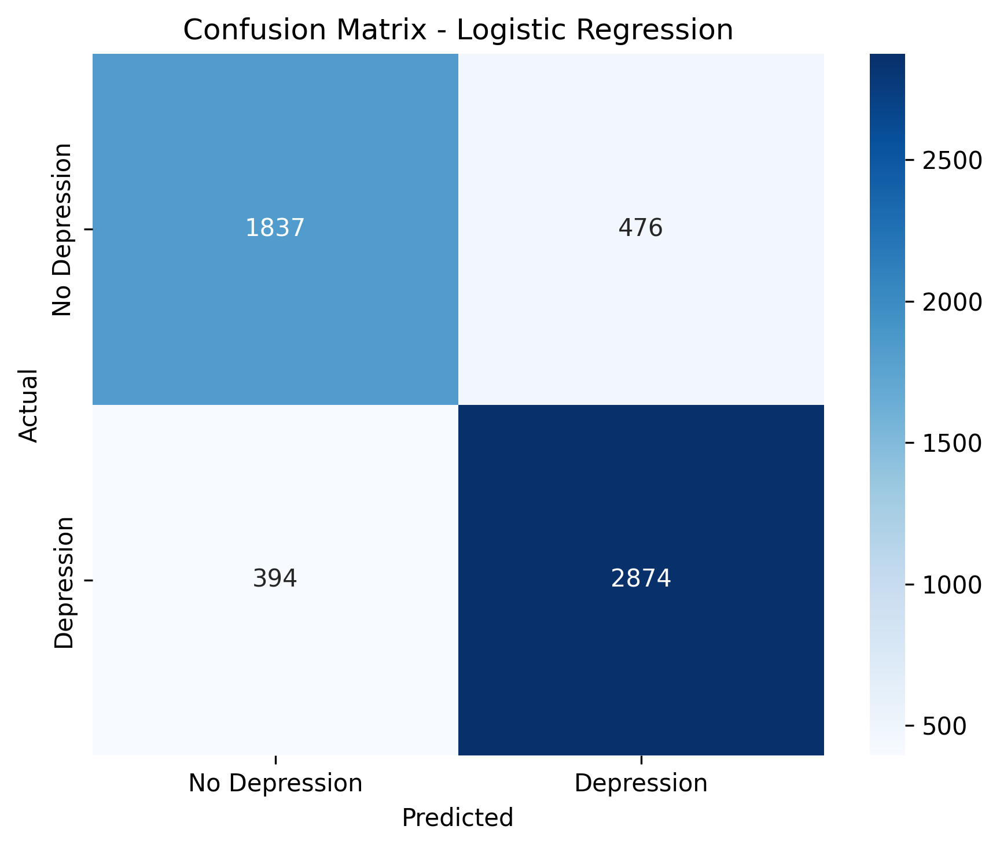

### Random Forest

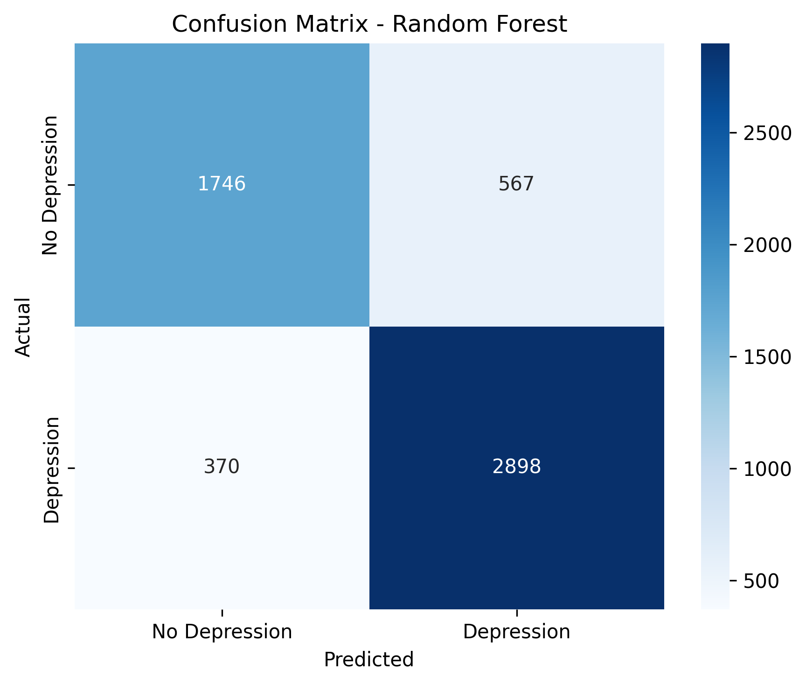

### Support Vector Machine

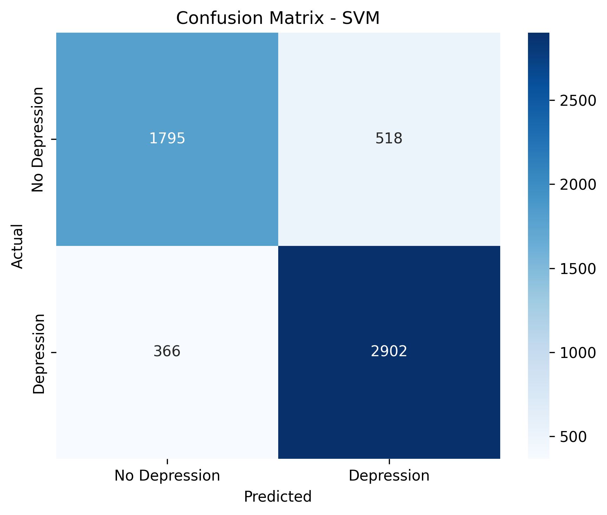

### XGBoost

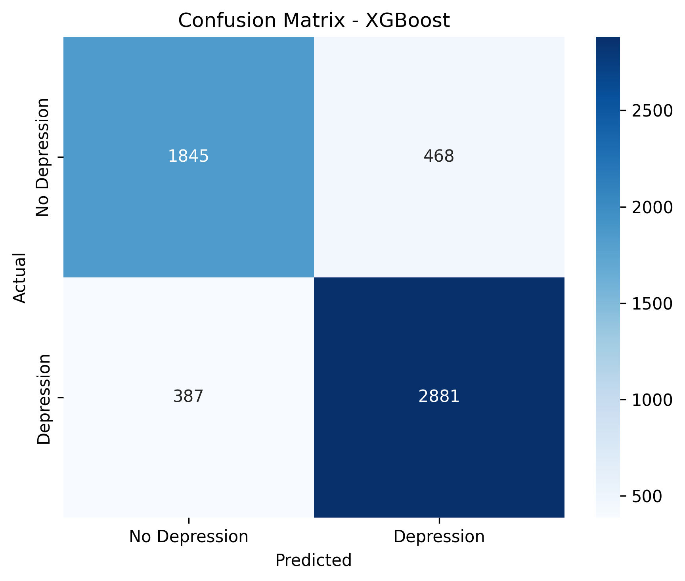

The project also stores evaluation results and cross-validation summaries in the `results/` directory. Refer to these files for the metrics produced by the corresponding experiments.

## Cross-Validation and Hyperparameter Tuning

The project includes scripts for evaluating model performance across validation folds and tuning XGBoost hyperparameters.

Relevant files:

- `src/cross_validation.py`
- `src/tune_xgboost.py`
- `results/cross_validation_summary.csv`
- `results/xgboost_hyperparameter_results.csv`
- `results/model_results.csv`
- `results/final_model_results.csv`

Cross-validation provides a more robust view of performance than a single train/test split, although results still depend on the data, split strategy, and experimental methodology.

## Feature Importance

Feature importance helps identify which variables the fitted XGBoost model relies on most when making predictions.

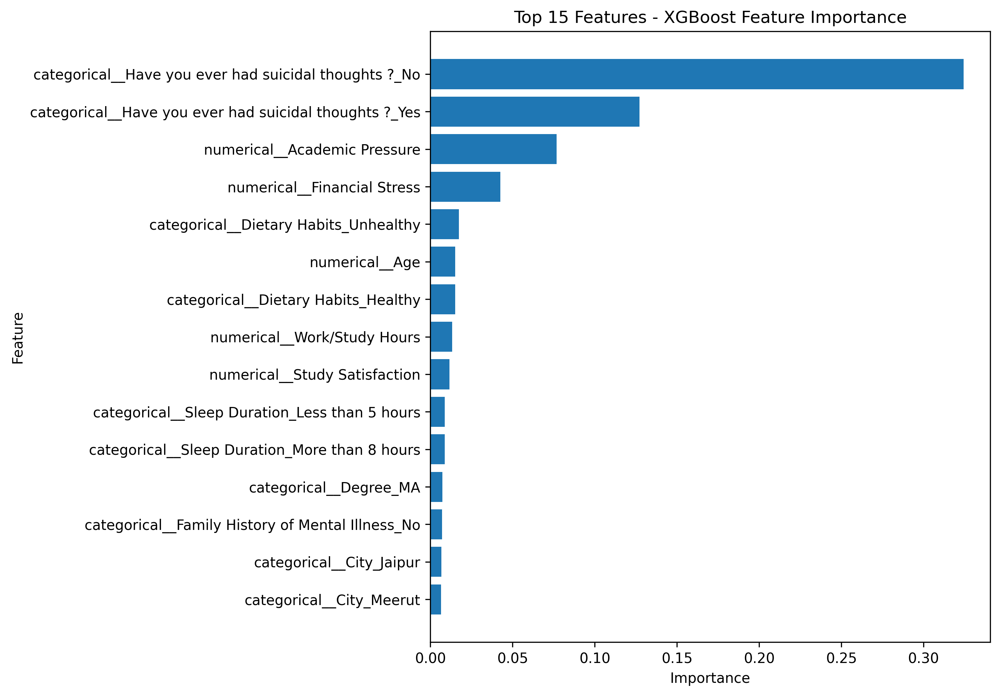

Feature importance describes model behavior, not causal relationships. A highly ranked feature is not necessarily a cause of depression.

## Explainable AI with SHAP

SHAP (SHapley Additive exPlanations) is used to investigate how input features contribute to model outputs.

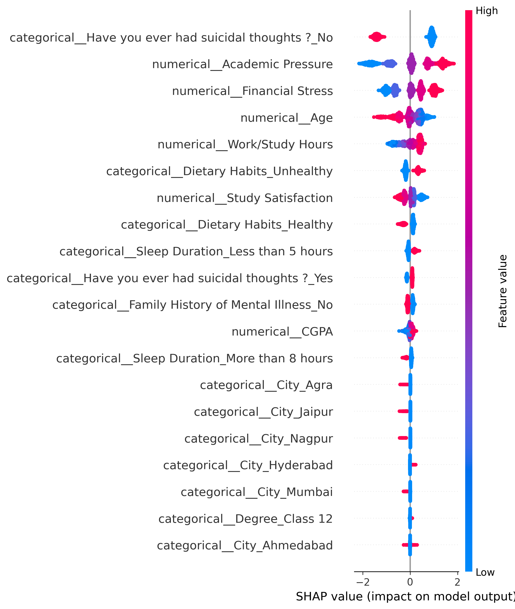

The summary plot visualizes the distribution and direction of feature contributions across evaluated samples. Interpretations depend on the fitted model, feature encoding, and data distribution.

### Sensitive Feature Analysis

The project includes a dedicated experiment for investigating sensitive features:

`src/sensitive_feature_experiment.py`

The self-reported suicidal-thoughts feature appears highly important in the supplied feature-importance analysis. Because it may overlap with the target label, its inclusion could create target leakage or an ethically inappropriate shortcut.

A responsible evaluation should compare performance with and without this feature, verify the target-label construction, and assess whether the model generalizes to independent data. Any such experiment should be documented with its own evaluation results.

## Streamlit Application

The project includes a Streamlit application implemented in `src/app.py`.

The application can be launched with:

```bash
streamlit run src/app.py
```

This command assumes the application and its dependencies are configured correctly. If the app expects model artifacts or data at specific paths, ensure those paths are valid in your local environment.

## Installation and Setup

### Prerequisites

- Python installed on your system
- Git
- pip

### 1. Clone the Repository

```bash
git clone https://github.com/subhrank09/student-depression-prediction-ml.git
cd student-depression-prediction-ml
```

### 2. Create a Virtual Environment

```bash
python -m venv .venv
```

Activate it on Windows:

```bash
.venv\Scripts\activate
```

### 3. Install Dependencies

```bash
python -m pip install --upgrade pip
pip install -r requirements.txt
```

### 4. Run the Application

```bash
streamlit run src/app.py
```

### 5. Run Analysis Scripts

Run scripts from the repository root as needed:

```bash
python src/inspect_dataset.py
python src/clean_data.py
python src/eda.py
python src/train_model.py
python src/cross_validation.py
python src/feature_analysis.py
python src/shap_analysis.py
python src/sensitive_feature_experiment.py
python src/tune_xgboost.py
```

**Note:** The scripts may depend on the execution order, dataset paths, installed packages, and previously generated model files. Check each script's configuration before running the full pipeline. Run training and tuning scripts only when you intend to regenerate the corresponding artifacts.

## Future Improvements

- Investigate target leakage and evaluate models with potentially sensitive features excluded.
- Add ROC curves, precision-recall curves, and class-wise evaluation metrics.
- Assess model calibration and prediction uncertainty.
- Validate on an independent dataset.
- Investigate fairness across appropriate demographic subgroups.
- Improve reproducibility with fixed random seeds and documented configurations.
- Add automated tests and continuous integration.
- Document model limitations and responsible-use guidelines.

## Limitations and Ethical Considerations

- Dataset labels may contain noise, bias, and self-reporting inconsistencies.
- Observational associations do not establish causation.
- Performance on one dataset does not guarantee generalization to other student populations.
- Sensitive features may introduce leakage, bias, and ethical risks.
- Mental health information requires careful privacy and security practices.
- This project must not be used as a substitute for professional mental health assessment or as the sole basis for consequential decisions.

## Author

**Subhrank Priya**

Computer Science and Engineering | Machine Learning | Data Science

GitHub: [subhrank09](https://github.com/subhrank09)

---

If you find this project useful, feel free to explore the implementation and suggest improvements.
